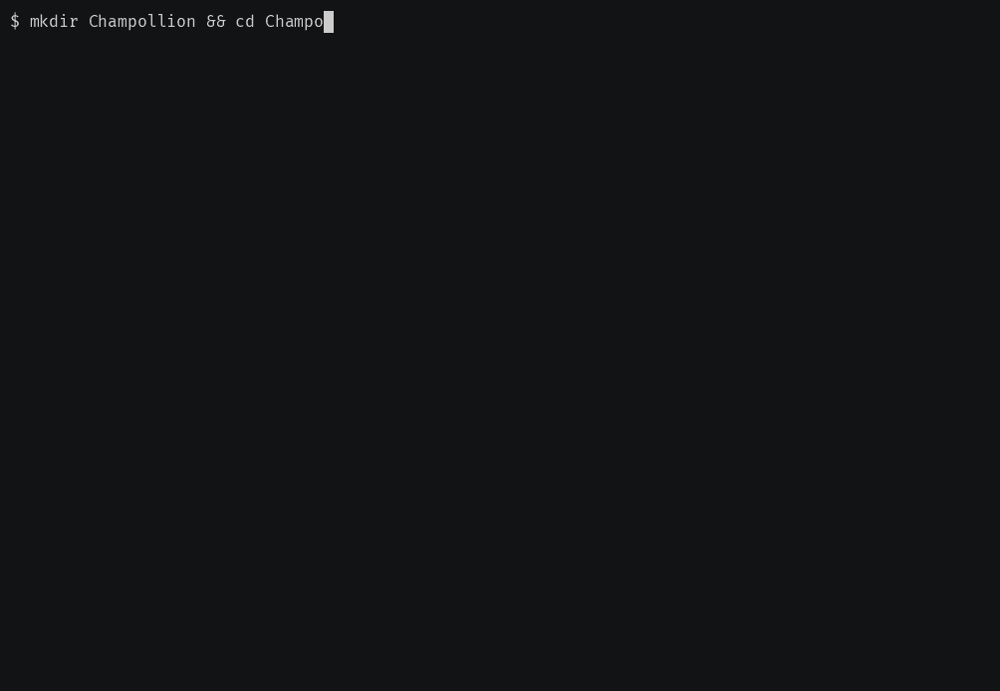

# Champollion Pipeline

[](https://www.python.org/)
[](https://pytorch.org/)
[](https://pixi.sh/)
[](https://cecill.info/licences/Licence_CeCILL-B_V1-en.html)
[](https://huggingface.co/neurospin/Champollion_V1)
[](https://huggingface.co/spaces/neurospin/Champollion_demo)

Cortical sulci — the folds of the brain surface — vary in shape across individuals and are linked to cognitive function, development, and neurological conditions. The **Champollion pipeline** turns T1 MRI scans into compact, comparable representations of sulcal morphology using self-supervised contrastive learning. It processes MRIs through the [BrainVISA/Morphologist](https://brainvisa.info) toolchain to extract sulcal graphs, uses *cortical_tiles* to crop standardized 3D patches around 28 sulcal regions per hemisphere, and then runs pre-trained Champollion encoders to produce 32-dimensional embeddings per region. These embeddings can be projected onto pre-trained UMAP reference maps for visualization and compared across cohorts. The pipeline is designed for researchers who want to apply Champollion to their own neuroimaging datasets without retraining.

> **Try it online:** A [live demo is available on Hugging Face Spaces](https://huggingface.co/spaces/neurospin/Champollion_demo). It runs on 2 CPU cores and is suited for quick testing with a single subject. For batch processing or production use, install this pipeline locally where it can leverage all available CPUs and GPUs.

## Quick start

Run the whole pipeline with one command — replace the placeholder paths with your own:

```bash
# <input>: a folder of T1 MRI files (nested folders included) or of Morphologist outputs
# <output>: the dataset root, where the derivatives are written (optional: inferred from <input>)
pixi run champollion-pipeline /data/myproject/sourcedata /data/myproject/
```

`champollion-pipeline` infers every other path of the Dataset from `<input>` and runs the enabled stages in order, with no Config file.
Common options: `--stages` selects the stages to run, `--embeddings-only` limits the run to the embeddings,
`--mode streaming` runs inference scan by scan, `--env <file>` reads the secrets and root paths from a file, and
`--log` writes a run log; `champollion-pipeline --help` lists every option.
See [Running champollion-pipeline without a Config file](docs/usage.md#running-champollion-pipeline-without-a-config-file).

<details>
<summary>All champollion-pipeline options</summary>

Every option of `champollion-pipeline --help`. An option given on the command line wins over the `--config` file;
Default is the value used when neither sets it. `-` in Argument: the option takes no value. `<repo>` is this
repository's root; OUTPUT is the dataset root (the second positional argument, or inferred from INPUT).

| Option | Argument | Default | Meaning |
|---|---|---|---|
| `-h`, `--help` | - | - | Show the help message and exit |
| `--config` | `CONFIG` | none | Configuration YAML file to load |
| `--generate-config` | `OUTPUT_PATH` | none | Write a configuration template, with the other options applied, to OUTPUT_PATH and exit |
| `--enable-all-stages` | - | off | Turn every stage on |
| `--stages` | `STAGE [STAGE ...]` | all six with INPUT and no config file; else `generate_embeddings` | Stages to run, the others turned off: `generate_morphologist_graphs`, `run_cortical_tiles`, `generate_champollion_config`, `generate_embeddings`, `put_together_embeddings`, `generate_snapshots` |
| `--mode` | `{sequential,streaming}` | `sequential` | Stage by stage over all scans, or scan by scan with one worker per scan (needs `--embeddings-only`) |
| `--dry-run` | - | off | Streaming mode: list the scans and report, without processing |
| `--n-workers` | `N` | `0` (CPU count) | Number of parallel scan workers in streaming mode |
| `--worker-timeout` | `SECONDS` | `7200` | Streaming mode: time limit of one scan's run; a longer run ends FAILED |
| `--stop-on-error`, `--no-stop-on-error` | - | on | Stop the run at the first failed stage |
| `--parallel`, `--no-parallel` | - | off | Stage 1: schedule Morphologist through soma-workflow |
| `--verbose`, `--no-verbose` | - | off | Verbose output; sets the log level to DEBUG unless `--log-level` is given |
| `--log-level` | `{DEBUG,INFO,WARNING,ERROR,CRITICAL}` | `INFO` | Log level of the pipeline logger |
| `--log-dir` | `LOG_DIR` | `<outputs-path>/logs` | Folder of the pipeline log file `pipeline.log` |
| `--log-to-file`, `--no-log-to-file` | - | on | Write `pipeline.log` in the log folder |
| `--log-to-console`, `--no-log-to-console` | - | on | Show the pipeline log on the console |
| `--log` | `[DIR]` | no run log | Write a run log per stage in DIR; bare `--log`: each stage's default log folder, plus this run's log in `./.log/` |
| `--profile` | `DIR` | off | Profile this run and its Python children into DIR (same as `CHAMPOLLION_PROFILE=DIR`) |
| `--profile-mode` | `{cpu,light}` | `cpu` | Profiling mode; needs `--profile` |
| `--env` | `[PATH]` | not read | Read `HF_TOKEN` and the `CHAMPOLLION_*` root paths from the .env file PATH; bare `--env`: `./.env` |
| `--input-path` | `INPUT_PATH` | none | Input to process: T1 MRI files or Morphologist outputs (same as INPUT) |
| `--input-kind` | `INPUT_KIND` | detected from INPUT | Kind of the input, `t1` or `morphologist` |
| `--output-path` | `DIR` | inferred from INPUT | Dataset root holding `derivatives/` (same as OUTPUT) |
| `--datasets-root` | `DATASETS_ROOT` | inferred from INPUT, else `<data-path>/<dataset-name>` | Dataset root holding `derivatives/` (same as OUTPUT) |
| `--data-path` | `DATA_PATH` | `<repo>/data` | Parent folder of the default dataset root |
| `--dataset-name` | `DATASET_NAME` | name of the dataset root folder | Dataset name, used in the generated Champollion configuration |
| `--outputs-path` | `OUTPUTS_PATH` | `OUTPUT/derivatives/champollion_V1` | Champollion output folder; the pipeline log folder defaults to its `logs/` |
| `--models-path` | `MODELS_PATH` | empty: stage 4 model source order | Local models folder, used when Hugging Face download is off |
| `--champollion-v1-path` | `CHAMPOLLION_V1_PATH` | `<repo>/external/champollion_V1` | Path of the champollion_V1 checkout; Config file field, read by no stage and not by champollion-train; kept so existing YAML files load |
| `--morphologist-graphs` | `MORPHOLOGIST_GRAPHS` | `OUTPUT/derivatives/morphologist-6.0` | Morphologist subjects folder read by stage 2 |
| `--path-to-graph` | `PATH_TO_GRAPH` | `t1mri/default_acquisition/default_analysis/folds/3.3/base` | Folder of the sulcal graphs below each subject |
| `--path-sk-with-hull` | `PATH_SK_WITH_HULL` | `t1mri/default_acquisition/default_analysis/segmentation` | Folder of the skeletons with hull below each subject |
| `--cortical-tiles-output` | `CORTICAL_TILES_OUTPUT` | `OUTPUT/derivatives` | Output folder of cortical_tiles (stage 2) |
| `--njobs` | `NJOBS` | `22` | Number of parallel jobs of cortical_tiles |
| `--sk-qc-path` | `SK_QC_PATH` | none | QC file passed to cortical_tiles |
| `--skel-seed` | `SKEL_SEED` | the seed in `pipeline_loop_2mm.json` | Skeleton seed passed to cortical_tiles |
| `--labelling-session` | `LABELLING_SESSION` | chosen per subject | Labelling session read by cortical_tiles and the snapshots |
| `--bids`, `--no-bids` | - | off | Input follows the BIDS layout (`subjects/sub-*/ses-*/...`); passed to cortical_tiles |
| `--allow-prefix-ids`, `--no-allow-prefix-ids` | - | off | Temporary: let cortical_tiles run when a subject ID is a strict prefix of another; its transforms may be wrong |
| `--allow-version-mismatch`, `--no-allow-version-mismatch` | - | off: a mismatch exits with status 2 | Run on when the given Mask version or per-region map differs from the local model set's: one WARNING per region model name, and the flag is passed to stage 4 |
| `--masks-version` | `MASKS_VERSION` | `canonical_corrected_26_1` | Mask version of the crops, embeddings and snapshots (`canonical_25` or `canonical_corrected_26_1`) |
| `--region-masks` | `REGION_MASKS [REGION_MASKS ...]` | none: read from a local model set | Mask version of each region model, as `NAME=VERSION` entries (e.g. `SC-sylv_left=canonical_25`), passed to stages 2, 3 and 4 instead of `--masks-version`; not with `--masks-version` |
| `--crops-path` | `CROPS_PATH` | inferred below `OUTPUT/derivatives` | 2mm crops folder read by stages 3 and 4 |
| `--regions` | `REGIONS [REGIONS ...]` | all 56 regions | Regions to crop and embed |
| `--embeddings-path` | `EMBEDDINGS_PATH` | `OUTPUT/derivatives/champollion_V1/<masks-version>/region_embeddings` | Per-region embeddings folder (stage 4 output, stage 5 input) |
| `--embeddings-only`, `--no-embeddings-only` | - | off | Inference-only run; required by `--mode streaming` |
| `--overwrite`, `--no-overwrite` | - | off | Recompute embeddings already present (stage 4) |
| `--cpu`, `--no-cpu` | - | off | Compute the embeddings on the CPU, without CUDA |
| `--checkpoint-epoch` | `CHECKPOINT_EPOCH` | `80` | Training epoch whose checkpoint computes the embeddings |
| `--checkpoint-epochs` | `CHECKPOINT_EPOCHS [CHECKPOINT_EPOCHS ...]` | none | Epoch of one model, as `<model id>=N`; wins over `--checkpoint-epoch` |
| `--per-model-folders`, `--no-per-model-folders` | - | off | Write the embeddings of each model to its own folder |
| `--models-cache` | `MODELS_CACHE` | `OUTPUT/derivatives/champollion_V1/models_cache` | Folder of the downloaded models |
| `--hf-enabled`, `--no-hf-enabled` | - | off | Take the models from the Hugging Face repository `--hf-repo-id` |
| `--hf-repo-id` | `HF_REPO_ID` | none | Hugging Face model repository, e.g. `neurospin/Champollion_V1` |
| `--model` | `MODEL` | every model id | Combine and snapshot only this model id (stages 5 and 6) |
| `--snapshots-path` | `SNAPSHOTS_PATH` | `OUTPUT/derivatives/champollion_V1/<masks-version>/snapshots` | Snapshots output folder (stage 6) |
| `--reference-data-path` | `REFERENCE_DATA_PATH` | none (UMAP snapshots skipped) | UMAP reference data folder of the snapshots |
| `--champollion-data-root` | `CHAMPOLLION_DATA_ROOT` | `CHAMPOLLION_DATA_ROOT` variable | Champollion data root passed to the snapshots |
| `--dataset-localization` | `DATASET_LOCALIZATION` | `local` | Name of the champollion_V1 dataset localization file used in streaming mode |
| `--datasets` | `DATASETS [DATASETS ...]` | `example` | Config file field, read by no stage and not by champollion-train; kept so existing YAML files load |
| `--labels` | `LABELS [LABELS ...]` | `Sex` | Config file field, read by no stage and not by champollion-train; kept so existing YAML files load |
| `--classifier-name` | `CLASSIFIER_NAME` | `svm` | Config file field, read by no stage and not by champollion-train; kept so existing YAML files load |
| `--subsets` | `SUBSETS [SUBSETS ...]` | `full` | Config file field, read by no stage and not by champollion-train; kept so existing YAML files load |
| `--epochs` | `EPOCHS [EPOCHS ...]` | none | Config file field, read by no stage and not by champollion-train; kept so existing YAML files load |
| `--split` | `SPLIT` | `random` | Config file field, read by no stage and not by champollion-train; kept so existing YAML files load |
| `--cv` | `CV` | `5` | Config file field, read by no stage and not by champollion-train; kept so existing YAML files load |
| `--splits-basedir` | `SPLITS_BASEDIR` | none | Config file field, read by no stage and not by champollion-train; kept so existing YAML files load |
| `--idx-region-evaluation` | `IDX_REGION_EVALUATION` | none | Config file field, read by no stage and not by champollion-train; kept so existing YAML files load |
| `--short-name` | `SHORT_NAME` | `eval` | Config file field, read by no stage and not by champollion-train; kept so existing YAML files load |

</details>

<details>
<summary>Advanced: running stages one by one</summary>

Each stage also has its own command; with `/data/myproject/` as the dataset root:

```bash
pixi run champollion-morphologist /data/myproject/sourcedata /data/myproject/
pixi run champollion-cortical-tiles /data/myproject/derivatives/morphologist-6.0 /data/myproject/derivatives/ \
    --path_to_graph "t1mri/default_acquisition/*/folds/3.1" \
    --path_sk_with_hull "t1mri/default_acquisition/default_analysis/segmentation"
pixi run champollion-config /data/myproject/derivatives/cortical_tiles-2026/crops/canonical_25/2mm \
    --dataset myproject --output /data/myproject/derivatives/champollion_V1/configs
pixi run champollion-embeddings neurospin/Champollion_V1 /data/myproject/ --masks canonical_25
pixi run champollion-combine /data/myproject/derivatives/champollion_V1/canonical_25/region_embeddings/ \
    --output_path /data/myproject/derivatives/champollion_V1/canonical_25/embeddings/
pixi run champollion-snapshots \
    --embeddings_dir /data/myproject/derivatives/champollion_V1/canonical_25/embeddings/ \
    --output_dir /data/myproject/derivatives/champollion_V1/canonical_25/snapshots/
```

[Usage](docs/usage.md) details each stage and lists every option.

</details>

Each run writes `replay_<timestamp>.yaml` in its logs folder, and `champollion-pipeline --config <that file>` rebuilds the
run's PipelineConfig; the secret `dataset.hf_token` is never written. See [Replay config](docs/usage.md#replay-config).

For inference on many scans, `champollion-pipeline --mode streaming --config my_pipeline.yaml` runs cortical_tiles and
the embeddings scan by scan, with one resident model; see [Streaming mode](docs/usage.md#streaming-mode).

The `main.py` file at the repository root remains as a backward-compatible shim of `champollion-pipeline`.

---

## 1. Installation

### Prerequisites

- [Pixi](https://pixi.sh/) package manager, version 0.80.0 or newer (`pixi.toml` declares `requires-pixi = ">=0.80.0"`). Check with `pixi --version`; upgrade an existing install with `pixi self-update`. Pixi older than 0.68 fails with `expected a string, found table` instead of a version message.
- Git
- [BrainVISA / Morphologist](https://brainvisa.info) — required for stage 1 only (sulcal graph extraction). If you already have Morphologist `.arg` graphs, you can skip stage 1 and start from stage 2.

### Setup

Clone the repository and install all dependencies:

```bash
mkdir Champollion && cd Champollion
git clone https://github.com/neurospin/champollion_pipeline.git
cd champollion_pipeline
pixi run install-all
```



The recording is played back ten times faster than real time. To record it again, run `scripts/record_install_demo.sh`.

`install-all` initializes the git submodules (`champollion_V1` and `cortical_tiles`), installs them in editable mode, clones `champollion_utils`, and creates the `data/` directory.

Prefer an interactive, guided setup instead? Run `./install.sh` (or `pixi run setup` once `pixi install -e default` has run) — the install wizard asks where you're running the pipeline and what you'll use it for, then runs the matching install command for you.

To enter the managed environment interactively:

```bash
pixi shell
```

### Uninstallation

```bash
pixi run uninstall        # Remove installed packages and cloned repos
pixi run uninstall-all    # Also remove Pixi-managed dependencies
```

> ⚠️ `uninstall-all` removes the `data/` folder as well. Back up any data stored there first.

### Updating an existing install

```bash
pixi run update
```

If you hit issues (submodule URL mismatch, missing `hatchling`, stale pixi tasks, etc.),
see [docs/migration.md](docs/migration.md) for symptoms and fixes.

---

## 2. Pipeline stages

`champollion-pipeline` runs these six stages in order; each also has its own console script. [Usage](docs/usage.md) gives each stage's examples, subsections and full option table.

| Stage | Command | Purpose | Details |
|---|---|---|---|
| 1 | `champollion-morphologist` | Segment T1 MRI scans into Morphologist sulcal graphs (skip it when you have `.arg` graphs) | [Stage 1](docs/usage.md#stage-1--generate-morphologist-graphs) |
| 2 | `champollion-cortical-tiles` | Crop 28 sulcal regions per hemisphere at 2 mm, plus a whole-brain volume | [Stage 2](docs/usage.md#stage-2--extract-sulcal-region-crops) |
| 3 | `champollion-config` | Write the Champollion YAML dataset configuration (training only) | [Stage 3](docs/usage.md#stage-3--generate-champollion-configuration) |
| 4 | `champollion-embeddings` | Compute the per-region embeddings with the pre-trained encoders | [Stage 4](docs/usage.md#stage-4--generate-embeddings) |
| 5 | `champollion-combine` | Collect the per-region embedding CSVs into one folder | [Stage 5](docs/usage.md#stage-5--combine-embeddings) |
| 6 | `champollion-snapshots` | Render sulcal graph, tile mask and UMAP snapshots | [Stage 6](docs/usage.md#stage-6--generate-visualization-snapshots) |

---

## Run logs

Every stage script takes `--log [PATH]` (champollion_utils 0.3.0 or later), and so does `generate_masks.py`.
With it, the run's whole output is also written to a run-log file.

`--log=PATH` writes the run log to the file PATH (missing parent folders are created).

A bare `--log` writes it to the script's default folder, in a file named `<stage>_<YYYYmmdd-HHMMSS>.log`:

| Script | Bare `--log` folder |
|---|---|
| `champollion-morphologist` | `<output>/derivatives/morphologist-6.0/.log` |
| `champollion-cortical-tiles` | `<output>/cortical_tiles-2026/.log` |
| `champollion-config` | `<dataset>/derivatives/champollion_V1/<masks>/.log` |
| `champollion-embeddings` | `<datasets_root>/derivatives/champollion_V1/<masks>/.log` |
| `champollion-combine` | `<--output_path>/.log` |
| `champollion-snapshots` | `<--output_dir>/.log` |
| `champollion-train` | `data/<dataset>/derivatives/champollion_V1/canonical_25/.log` |
| `champollion-prune` | `<dataset>/derivatives/.log` |
| `champollion-purge` | `<dataset>/derivatives/.log` |
| `champollion-labelling-qc` | `.log` next to the output TSV |
| `champollion-pipeline` | `./.log` |
| `generate_masks.py` | `<--output_dir>/.log` |

A bare `--log` placed just before a positional argument takes that argument as its PATH: pass `--log=PATH`,
or put a bare `--log` last or before another option.

The run log holds everything written to standard output and standard error during the run, including the
output of every child process (for example the `Running command:` lines and their subprocess output).

It starts with a header giving the command line, the working directory, the start time and the process id.

It ends with a footer giving the exit code and the elapsed time.

The terminal still shows the same output, unchanged: the run log is a copy.

`champollion-pipeline` runs the stages in-process: with a bare `--log`, each stage writes its own run log to that stage's
default folder above.

`champollion-pipeline --log=DIR` writes one run log per stage, `DIR/<stage>_<YYYYmmdd-HHMMSS>.log`.

In a pipeline config file, the top-level key `log:` does the same (`null`: no run log, `""`: each stage's
default folder, a path: that directory); the command line wins over the config.

---

## Project Structure

```
champollion_pipeline/
├── external/
│   ├── champollion_V1/         # Self-supervised encoder submodule (contrastive learning)
│   └── cortical_tiles/         # Sulcal region crop extraction submodule
├── reference_data/             # NOT shipped (gitignored) — pre-trained UMAP models go here, obtained separately
├── src/
│   └── champollion_pipeline/   # Installable Python package (entry points: champollion-*)
│       ├── cli.py                   # Pipeline orchestrator and command line (champollion-pipeline)
│       ├── pipeline_stages.py       # The six pipeline stage classes run by champollion-pipeline, and their path helpers
│       ├── generate_morphologist_graphs.py
│       ├── run_cortical_tiles.py
│       ├── derivatives_layout.py
│       ├── path_inference.py        # Infers the dataset root and Morphologist graph folder from the input path
│       ├── generate_champollion_config.py
│       ├── generate_embeddings.py
│       ├── put_together_embeddings.py
│       ├── generate_snapshots.py
│       ├── train_champollion.py
│       ├── generate_masks.py
│       ├── prune_failed_subjects.py
│       ├── purge_subject.py
│       ├── profile_report.py        # Aggregates a --profile run dir into report.json (pixi run profile-report)
│       ├── input_kind_choice.py     # Asks or stops on an ambiguous champollion-pipeline input (--input-kind)
│       ├── process_setup.py
│       ├── cli_options.py           # Registry of champollion-pipeline arguments, one per config field
│       ├── env_file.py              # Reads champollion-pipeline --env files and CHAMPOLLION_* variables (python-dotenv)
│       ├── replay_config.py         # Writes the replay config of a champollion-pipeline run into its logs folder (--config replays it)
│       ├── run_masks.py             # Resolves the run's per-region Mask version map once before stage 1 (--region-masks)
│       ├── mask_version_checks.py   # Stops champollion-pipeline before stage 1 when a Mask version contradicts the local model set (--allow-version-mismatch)
│       ├── _stage_base.py           # Template base class of the pipeline stages of champollion-pipeline
│       └── generate_labelling_qc.py
├── data/                       # Created by install-all; not committed
└── pixi.toml
```

### Console scripts

Installing the package provides these entry points, declared in
`pyproject.toml`'s `[project.scripts]`:

| Command | Module | Purpose |
|---|---|---|
| `champollion-morphologist` | `generate_morphologist_graphs.py` | Step 1 — run Morphologist over raw T1 MRI to produce sulcal graphs |
| `champollion-cortical-tiles` | `run_cortical_tiles.py` | Step 2 — extract sulcal region crops from Morphologist graphs |
| `champollion-config` | `generate_champollion_config.py` | Step 3 — write the Champollion YAML dataset configuration |
| `champollion-embeddings` | `generate_embeddings.py` | Step 4 — compute per-region embeddings from a pre-trained model |
| `champollion-combine` | `put_together_embeddings.py` | Step 5 — collect the per-region CSVs into one output directory |
| `champollion-snapshots` | `generate_snapshots.py` | Step 6 — render UMAP visualization snapshots |
| `champollion-train` | `train_champollion.py` | Optional — train a `champollion_V1` encoder for one sulcal region |
| `champollion-prune` | `prune_failed_subjects.py` | Maintenance — delete cortical_tiles outputs for QC-failing subjects |
| `champollion-purge` | `purge_subject.py` | Maintenance — delete all cortical_tiles derivatives for one subject |
| `champollion-labelling-qc` | `generate_labelling_qc.py` | QC — flag subjects whose Morphologist labelled graphs (e.g. `deepcnn_session_auto`) are missing, so they will be left out of the whole-brain output |
| `champollion-pipeline` | `cli.py` | Pipeline — run the enabled stages in order, with one option per config field |

`generate_masks.py` also ships in the package but declares no console script.

## Testing

```bash
pixi run test               # All tests
pixi run test-unit          # Unit tests only
pixi run test-integration   # Integration tests only
pixi run test-smoke         # Smoke tests only
pixi run test-cov           # Tests with coverage report
pixi run test-fast          # Stop on first failure
```

## Troubleshooting

### `ModuleNotFoundError: No module named 'champollion_pipeline'`

The Python package is installed by `pixi run install-all` (first-time setup) or `pixi run install-embeddings` (embeddings env only). If you reinstalled Pixi, changed environments, or ran `pixi run uninstall`, run the install step again before any pipeline task:

```bash
pixi run install-embeddings   # re-installs champollion_pipeline, champollion_V1, and champollion_utils
```

This must be run from the repository root (the directory containing `pixi.toml`).

### `pixi run champollion-embeddings` task not found

The `champollion-*` entry-point tasks were added in a recent release. If you are on an older checkout, update first:

```bash
pixi run update-pipeline   # pulls latest code and pixi.lock from origin
pixi run install-embeddings
```

### `pixi run update-submodules` fails with a rebase conflict

If a submodule has local commits that conflict with the remote tip, the update aborts. These submodules are upstream dependencies — local commits inside them are not expected. Run:

```bash
git submodule update --init --remote --force external/champollion_V1
git submodule update --init --remote --force external/cortical_tiles
```

This resets each submodule to the remote tip, discarding any local commits inside it.

---

## Dependencies

All dependencies are managed through `pixi.toml`. Core requirements:

- Python ≥ 3.10
- PyTorch
- BrainVISA / Morphologist (for stage 1 only — see [brainvisa.info](https://brainvisa.info))
- huggingface-hub
